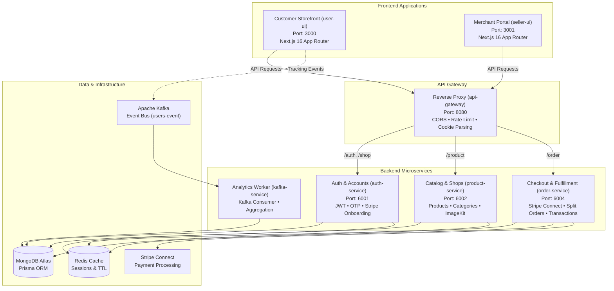

# 🛒 HashCart — Enterprise Multi-Vendor E-Commerce Platform

HashCart is a production-grade, distributed multi-vendor e-commerce platform built as an **Nx Monorepo**. It features decoupled microservices powered by **Express.js**, modern server-rendered frontends powered by **Next.js 16 (App Router)**, real-time analytics streaming via **Apache Kafka**, distributed session management with **Redis**, and a unified document database on **MongoDB Atlas** managed through **Prisma ORM**.

---

## 🏗️ Architecture Overview



---

## 📦 Monorepo Structure

```
d:/MultiVendorEcommerce/
├── apps/
│   ├── api-gateway/         # Port 8080 - Reverse proxy routing all traffic
│   ├── auth-service/        # Port 6001 - User/Seller Auth, Addresses, Shop registration
│   ├── product-service/     # Port 6002 - Products, Categories, Discounts, ImageKit upload
│   ├── order-service/       # Port 6004 - Cart Sessions, Stripe Connect, Atomic Orders
│   ├── kafka-service/       # Event consumer processing analytics (shop visits, cart actions)
│   ├── user-ui/             # Port 3000 - Customer marketplace, checkout & profile
│   └── seller-ui/           # Port 3001 - Seller dashboard, inventory, discount codes
├── packages/
│   ├── error-handler/       # Custom error classes (AuthError, ValidationError, NotFoundError)
│   ├── libs/                # Shared Prisma client instance
│   ├── redis/               # Centralized Redis connection instance
│   ├── rich-text-editor/    # Tiptap WYSIWYG editor for product descriptions
│   └── utils/               # Shared utilities, Kafka producer, token generators
└── prisma/
    └── schema.prisma        # MongoDB Prisma models and enum definitions
```

---

## ⚡ Port & Routing Matrix

| Service | Port | Base Path | Key Responsibilities |
| :--- | :--- | :--- | :--- |
| **API Gateway** | `8080` | `http://localhost:8080/api` | Central reverse proxy, CORS, cookie forwarding, rate-limiting |
| **Auth Service** | `6001` | `/auth`, `/shop` | Customer/Seller Auth, OTP verification, Address CRUD, Stripe link |
| **Product Service** | `6002` | `/product` | Product CRUD, Filters, Offers, Categories, Discount coupons |
| **Order Service** | `6004` | `/order` | Payment sessions, Stripe PaymentIntents, Webhook, Split Orders |
| **Kafka Worker** | *Daemon* | *N/A* | Consumes `users-event` topic, calculates real-time analytics |
| **User UI** | `3000` | `http://localhost:3000` | Responsive customer storefront, cart, checkout, profile |
| **Seller UI** | `3001` | `http://localhost:3001` | Merchant dashboard, product management, discount management |

---

## 🔍 Platform Status: Completed vs. Remaining

### ✅ What is Fully Completed & Working

#### 1. Authentication & Identity (`auth-service`)
- [x] Multi-role authentication (Customer and Seller).
- [x] Email OTP verification using EJS email templates and Nodemailer.
- [x] JWT access and refresh token rotation with secure HTTP-only cookies.
- [x] Forgot password and reset password flows.
- [x] Seller onboarding with shop creation and Stripe Connect Account Links.
- [x] Full shipping address management (`add-address`, `get-addresses`, `update-address`, `delete-address`) with default address designation.

#### 2. Catalog & Products (`product-service`)
- [x] Product creation and multi-image uploads via ImageKit.
- [x] Rich text product descriptions using TipTap editor.
- [x] Category and subcategory taxonomy.
- [x] Product search, price range filtering, category filtering, and sorting.
- [x] Flash deals / offers query endpoint (`get-offer-products`).
- [x] Seller discount coupons creation and percentage/flat amount validation.

#### 3. Orders & Payment Engine (`order-service`)
- [x] **Redis Payment Sessions**: 30-minute snapshot preserving cart items, address, and applied coupons with atomic UUID session IDs.
- [x] **Stripe Connect Integration**: Direct and destination charges supporting multi-seller payouts with platform fee deduction.
- [x] **Dual Checkout Support**:
  - **Cash on Delivery (COD)**: 1-click order placement via `POST /order/create-direct-order`.
  - **Online Payment**: Stripe PaymentIntent creation (`POST /order/create-payment-intent`) and automatic card confirmation.
- [x] **Multi-Vendor Order Splitting**: Automatic item decomposition by `shopId` creating independent sub-orders per vendor.
- [x] **Atomic Prisma Transactions (`prisma.$transaction`)**: All-or-nothing database writes ensuring inventory decrement, sales increment, and order creation execute in a single commit.
- [x] **Order Cancellation & Stock Restoration**: Customers can cancel pending orders with automatic atomic inventory rollbacks.
- [x] **Stripe Webhook Handler**: Secure signature verification (`stripe.webhooks.constructEvent`) handling `payment_intent.succeeded`.

#### 4. Customer Storefront (`user-ui`)
- [x] Modern obsidian/champagne storefront design with dynamic hero banners.
- [x] Live cart management with Zustand, persistent local state, and device/location tracking.
- [x] Address selection modal directly inside the checkout drawer.
- [x] Anti-autofill Stripe test card payment modal.
- [x] Customer account profile with live order status pills (`Pending`, `Paid`, `Shipped`, `Delivered`, `Cancelled`).
- [x] Wishlist toggling and synchronization.

---

### ⏳ What is Remaining / In Progress (Roadmap)

| Feature | Target App / Service | Description & Next Steps |
| :--- | :--- | :--- |
| **Seller Orders UI** | `seller-ui` | Backend has `GET /order/get-seller-orders` and `PUT /order/update-order-status/:id`. Need to build the `/dashboard/orders` table in `seller-ui` so sellers can view incoming orders and update delivery stages. |
| **Customer Reviews Submission** | `user-ui` & `product-service` | The Prisma schema contains `shopReviews` and rating averages. Need to add an interactive star-rating and comment form on the single product page (`/product/[slug]`). |
| **Transactional Email Dispatch** | `order-service` | Send email receipts to the customer and order alert notifications to sellers upon order placement (COD or Stripe success). |
| **Real-time Chat / Inbox** | `apps/chat-service` (Future) | Customer-to-seller messaging placeholder in `profile/page.tsx` (`inbox-tab.tsx`) requires WebSocket / Socket.io microservice integration. |
| **Analytics Visual Charts** | `seller-ui` | `kafka-service` stores visits and actions in `shopAnalytics`. Need to connect Recharts graphs in the seller dashboard overview. |

---

## 🚀 Getting Started

### Prerequisites
- **Node.js**: v20+ or v22+
- **MongoDB Atlas**: Connection URI with replica set (required for Prisma transactions)
- **Redis Server**: Local running instance (`localhost:6379`) or Redis Cloud
- **Stripe Account**: API test keys (`sk_test_...` and `pk_test_...`)

### 1. Installation
Clone the repository and install dependencies:
```bash
git clone <repository-url>
cd MultiVendorEcommerce
npm install
```

### 2. Environment Setup
Create `.env` files in the respective app directories:

**`apps/api-gateway/.env`**:
```env
PORT=8080
AUTH_SERVICE_URL=http://localhost:6001
PRODUCT_SERVICE_URL=http://localhost:6002
ORDER_SERVICE_URL=http://localhost:6004
FRONTEND_URL=http://localhost:3000
SELLER_FRONTEND_URL=http://localhost:3001
REDIS_URL=redis://127.0.0.1:6379
```

**`apps/order-service/.env`**:
```env
PORT=6004
DATABASE_URL="mongodb+srv://<username>:<password>@cluster0.mongodb.net/multivendor"
REDIS_URL=redis://127.0.0.1:6379
STRIPE_SECRET_KEY="sk_test_..."
STRIPE_WEBHOOK_SECRET="whsec_..."
```

### 3. Generate Database Client
```bash
npx prisma generate
```

### 4. Running the Development Servers

Run all backend microservices and frontends simultaneously with Nx:
```bash
# Start all microservices and frontends
npm run dev

# Or start individual applications
npx nx serve api-gateway
npx nx serve auth-service
npx nx serve product-service
npx nx serve order-service
npx nx serve user-ui
npx nx serve seller-ui
```

### 5. Order Fulfillment & Lifecycle State Machine
Orders follow a strict forward lifecycle state machine:
- **`Pending`**: Order created, awaiting confirmation.
- **`Processing`**: Order confirmed and in preparation. *(Cannot revert back to Pending)*.
- **`Shipped`**: Order dispatched to logistics. *(Cannot revert back to Processing or Pending)*.
- **`Delivered`**: Order fulfilled successfully (Terminal state, payment marked Paid).
- **`Cancelled`**: Order cancelled. Automatically triggers atomic inventory stock restoration transaction.

---

## 📊 Project Completion Status

| Milestone / Component | Status | Details |
|---|:---:|---|
| **API Gateway & Routing** | ✅ Completed | Redis caching, rate limiting, CORS, reverse proxy |
| **Auth Service (User & Seller)** | ✅ Completed | JWT, refresh token cookies, OTP mail verification, Stripe Connect |
| **Catalog & Products Service** | ✅ Completed | CRUD, ImageKit upload, AI enhancement, Quill editor, categories |
| **Orders & Checkout Service** | ✅ Completed | COD, Stripe Connect payment intent, multi-shop order splitting |
| **Order Lifecycle State Machine** | ✅ Completed | Forward-only status validation & atomic inventory recovery |
| **Analytics & Kafka Service** | ✅ Completed | Kafka event stream, user visits, device and country analytics |
| **Seller Dashboard & Analytics** | ✅ Completed | Recharts spline curve, device donut, React Simple Maps world map |
| **Seller Orders Management** | ✅ Completed | Live search, status filters, lifecycle status dropdown |
| **Customer Storefront (`user-ui`)**| ✅ Completed | Home, faceted search, product details, cart, checkout, profile |
| **Product Reviews Submission UI** | ⏳ Remaining | Customer review modal on product page & delivered orders |
| **Order Tracking Stepper for Buyers**| ⏳ Remaining | Visual progress bar on buyer profile order card |
| **PDF Invoices / Email Receipts** | ⏳ Remaining | Downloadable invoice and fulfillment emails to buyers |
| **Super Admin Platform Portal** | ⏳ Remaining | Platform owner panel for approving sellers and global stats |

---

## 🛠️ Testing the Checkout Flow

1. Open **Customer Storefront** at `http://localhost:3000`.
2. Register or log in to a customer account.
3. Add products to cart and proceed to `/cart`.
4. Select or add a shipping address.
5. Choose payment method:
   - **Cash on Delivery (COD)**: Click **"Confirm Order"** for instant order creation.
   - **Pay Online**: Click **"Pay Online"**, confirm the test card popup, and the system executes `createPaymentSession` ➔ `createPaymentIntent` ➔ `verifyPaymentAndCreateOrder` with atomic rollback guards.
6. Check your orders in `http://localhost:3000/profile` under the **Orders** tab!
7. Switch to **Seller Portal** (`http://localhost:3001/dashboard/orders`) to fulfill the order through the forward lifecycle (`Pending` ➔ `Processing` ➔ `Shipped` ➔ `Delivered`).

